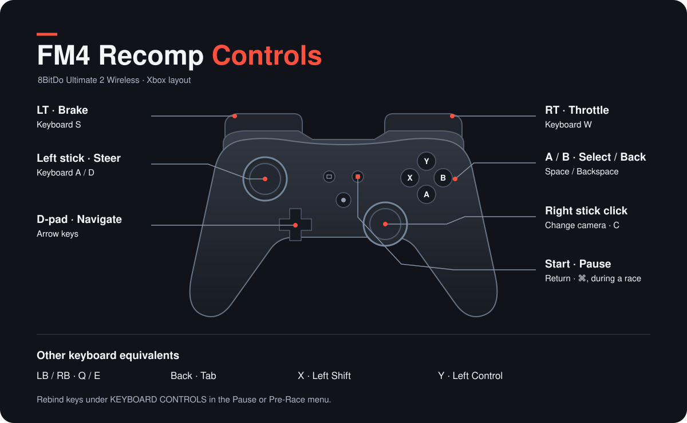

# Getting started

> [!NOTE]
> **FM4 Recomp 0.1.0** is available: the first public beta, an early and unoptimised build.
> Download `FM4-Recomp-0.1.0.dmg` from the [release page](https://github.com/retronative/fm4-recomp/releases/tag/v0.1.0), which also has the release
> notes. See [Status and releases](status.md) for its known issues.

## What you will need

- **An Apple silicon Mac** (M-series). Intel Macs are not supported.
- **macOS 26 or later.** The beta has been tested on macOS 27.0.1.
- **Your own copy of the game:** *Forza Motorsport 4* for Xbox 360, USA version, Disc 1 (the Play
  Disc), as a disc image you made from your own disc. Other versions are refused. See
  [Compatibility](compatibility.md).
- **About 9 GB of free disk space** for the game data.
- **Optional: your Disc 2** (the Content Install Disc) as a disc image: about 3.2 GB for its files
  and about 3 GB more when the game installs its content. Disc 1 alone still plays.
- **A gamepad or the keyboard.** A gamepad that SDL recognises on macOS, in the Xbox layout.

FM4 Recomp is an unofficial fan project and never ships any game data: no disc files, artwork,
audio, tracks or cars (what the app does contain: the [legal notice](LEGAL.md)). Nothing else is
needed: the app includes everything it runs. No Homebrew, Xcode or developer tools.

## Install

1. **Download the DMG.** Get `FM4-Recomp-0.1.0.dmg` from the [release page](https://github.com/retronative/fm4-recomp/releases/tag/v0.1.0). To check it, run `shasum -a 256 FM4-Recomp-0.1.0.dmg` in
   Terminal, in the folder with the download. It must print
   `b471494684c0f409875908a3bc8cfdd2aff21a1a7810e861395b42924f02dfca`.
2. **Move the app to Applications.** Open the disk image and drag **FM4 Recomp** onto **Applications**. Open it from
   Applications.
3. **Allow the first launch.** The beta is ad hoc signed and **not notarised**: Apple has not checked it,
   so macOS may refuse to open it the first time. Opening it anyway is your own decision to make
   an exception for this app; do it only for a download whose checksum matches. Open **System
   Settings → Privacy & Security**, choose **Open Anyway** for FM4 Recomp, and open it again.
4. **Choose your Disc 1 image.** FM4 Recomp checks your Mac, then asks where to keep the game data and
   your saves: your Library by default, or any folder, an external SSD included (keep that drive
   connected to play). Choose your Disc 1 image or drop it on the window. Setup copies and checks
   the game files, which takes a few minutes; your disc image is only read, and every file is
   checked against the version this build was made for.
5. **Play.** Press **Play**. Once set up, opening FM4 Recomp starts the game directly. If the game
   data is missing (moved, deleted, or on a drive that is not connected), the app opens Repair
   instead.

Pressing A skips the long welcome video before the first race. The original game cannot skip it;
FM4 Recomp adds that.

## Disc 2

Disc 2 is optional. If you choose to install it in the game, FM4 Recomp's Disc 2 panel opens over
the game's "Insert Disc 2" screen: drop or choose your Disc 2 image and where its files go, and
watch the progress (Cancel and Try Again are there). The panel closes once Disc 2 is ready, and
the game then shows its own "Install Additional Content" screen; confirm with A.

## Controls

| Gamepad (Xbox layout) | Keyboard (default) |
|---|---|
| Left stick: steer | A / D |
| Right trigger: throttle | W |
| Left trigger: brake | S |
| A / B / X / Y | Space / Delete (Backspace) / Left Shift / Left Control |
| D-pad | Arrow keys |
| Start / Back | Return / Tab |
| LB / RB | Q / E |
| Right stick click: camera | C |

The keyboard keys are changed in the game: choose **KEYBOARD CONTROLS** in the Pause menu (Start,
or **Command-comma (⌘,)** during a race) or on the Pre-Race screen. Changes are saved at once and
apply in every later session. The gamepad layout is fixed.

## Sessions and GPU safeguards

FM4 Recomp is early software that drives the GPU hard, so every session runs with safeguards that
are always on:

- One session at a time, with a time limit, ending when you close the game window.
- After each session the system log and crash reports are searched for a GPU hang or restart. On
  any evidence FM4 Recomp writes a `GPU_STOP` file in `~/Library/Application Support/FM4 Recomp`
  and refuses to start again until you have read it and deleted it yourself.
- **Debug mode** runs the game with the Vulkan validation layer and Metal API validation, and
  stops at the first validation message. It is much slower and meant for reports.

Session logs are kept in `~/Library/Application Support/FM4 Recomp/logs/`. A session's folder
holds the game's log (it contains folder paths on your Mac), captured frames of the game, the
microcode of any shader the build refused, and an excerpt of the macOS system log for the session,
which can include other apps' Metal messages. Nothing is sent anywhere. When you report a problem,
send the text log only, after looking through it; never attach captured frames.

## Known issues

This is a beta. The main known issues are on the [Status and releases](status.md#known-issues)
page: a low frame rate, a stutter and an abrupt start before a race, and features that stop the
game with a named message.

## Uninstall

Quit FM4 Recomp, move it from Applications to the Bin, and delete
`~/Library/Application Support/FM4 Recomp` (and the folders you chose in setup, if you chose
others). That removes the game data, your saves and the session logs. Your disc images are never
changed.

## Building from source

Developers build FM4 Recomp from this repository with their own discs: see
[CONTRIBUTING.md](../CONTRIBUTING.md).
